  

  <i>A traveler who collects programming languages the way some mages collect 
  obscure spells. The journey is the point.</i>

 

  

 

  

 

  

 

  

 

  <i>Every small commit is a step. Someday, looking back, the whole road will make sense.</i>

