  

  

  <i>A traveler who collects programming languages the way some mages collect obscure spells. 
  Some are powerful. Some are just for fun. Each one is worth learning.</i>

 

<h2 align="center">📜 The Grimoire</h2>

<b>⚔️ Offensive Magic · Systems</b>

  
  
  
  

<b>🌸 Everyday Spells · Web &amp; Scripting</b>

  
  
  

<b>🔮 Memory Vaults · Databases</b>

  
  
  

<b>🎒 Party Equipment</b>

  

 

<h2 align="center">⏳ Memories of the Journey</h2>

  
  

  

 

<h2 align="center">🌿 The Trail Left Behind</h2>

  

 

  <i>Every small commit is a step. Someday, looking back, the whole road will make sense.</i>

  

